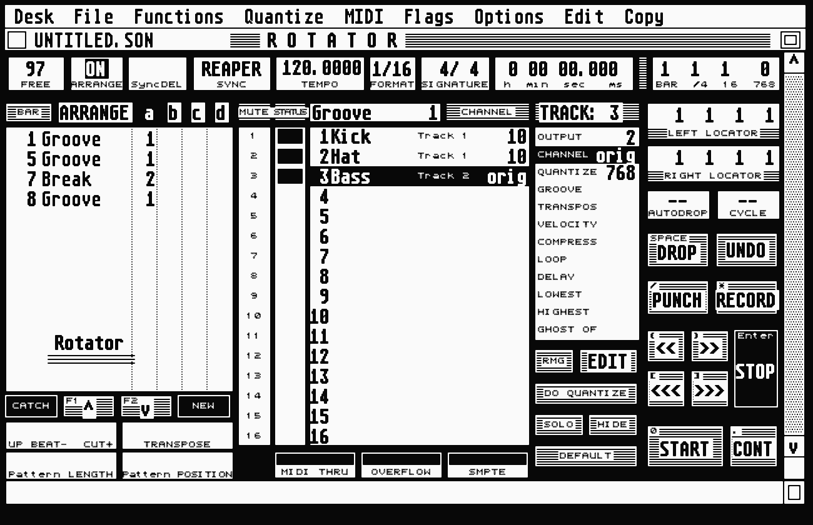
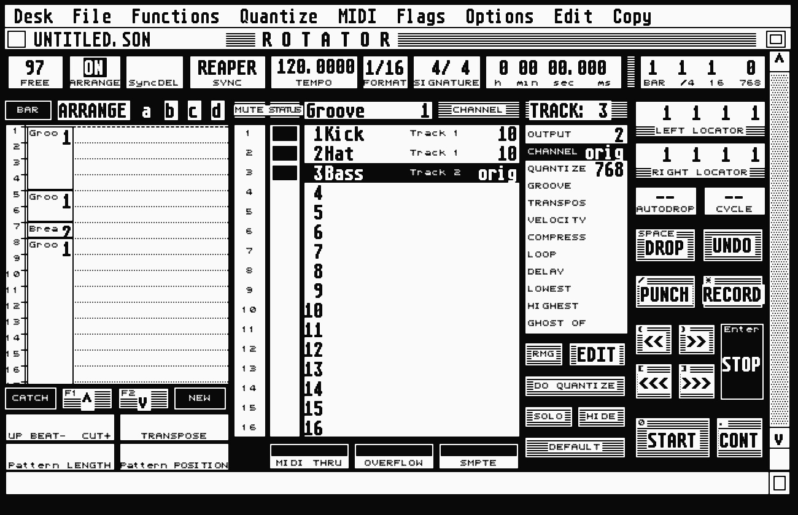
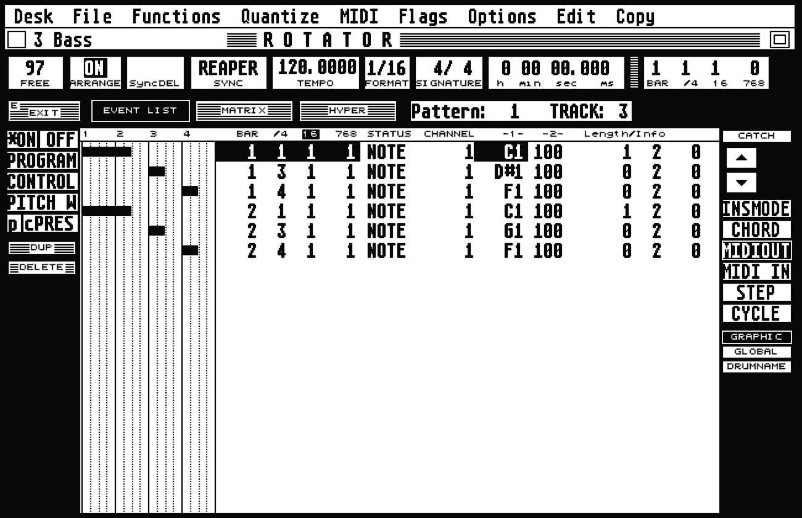
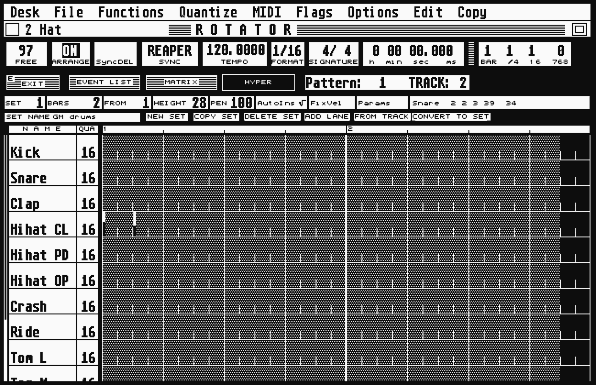
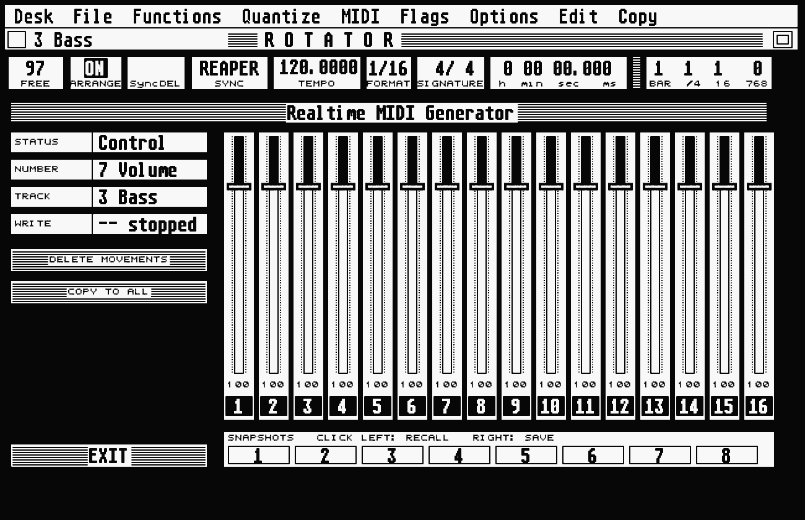

# Rotator

A pattern/arrange MIDI sequencer for [REAPER](https://www.reaper.fm), in the style of a classic 1990 Atari ST sequencer — monochrome GEM look included.

You write short **patterns** of up to 16 tracks, then place them in an **arrangement** of four parallel chains. REAPER plays the result: Rotator renders the arrangement into ordinary MIDI items on your REAPER tracks and keeps them up to date as you edit.



## Features

- **Main page** with the arrange list (or graphic arrange), 16-track list with MUTE/STATUS columns, track parameter box, locators and transport — all on one 640×400 Atari-style screen, scaled to the window.
- **Track parameters**, applied on playback: output (a REAPER track) and channel, quantize, groove (16A–8F swing presets and user grooves), transpose, velocity, compress, loop (polymeter), delay, note range, ghost tracks, output and channel filters.
- **Arrange**: four chains a–d, entry transpose, upbeat/cut, per-entry mutes and mute groups, solo, graphic arrange with drag, copy and length editing.
- **Editors**: event list, matrix and Hyper Edit (drum lanes with velocity beams).
- **Recording** straight into a pattern track, with count-in and cycle overdub.
- **RMG**: 16 controller faders with snapshots, written into the track while REAPER plays.
- Original-style value editing: click/right-click, press-and-slide, Cmd+mouse.

| Graphic arrange | Event list |
|---|---|
|  |  |
| **Hyper Edit** | **RMG** |
|  |  |

See [docs/TUTORIAL.md](docs/TUTORIAL.md) for a walkthrough.

## Requirements

- REAPER 7 on macOS (Apple Silicon or Intel)
- [ReaImGui](https://github.com/cfillion/reaimgui) 0.10, installed via ReaPack

## Install

In REAPER: Extensions → ReaPack → Import repositories…, paste

```
https://github.com/compjuicer/rotator/raw/main/index.xml
```

then install **Rotator** from Extensions → ReaPack → Browse packages, and restart REAPER. Install ReaImGui the same way if you don't have it.

## Building

```sh
cmake -S . -B build -G Ninja
cmake --build build
cmake --build build --target install_link   # symlinks the plugin into REAPER's UserPlugins
./build/model_tests                          # unit tests
```

Restart REAPER, then run the action **Rotator: Show window**.

This dev build hot-reloads the core and has a file bridge for the `tools/` scripts. `-DROTATOR_DEV=OFF` builds the single self-contained plugin that ships; `tools/release <version>` builds it, publishes a GitHub release and updates `index.xml`.

## Status

Hobby project, work in progress. Not affiliated with the makers of the original program.

## License

MIT (see [LICENSE](LICENSE)). Bundled: the Atari ST system font from [atarist-font](https://github.com/ntwk/atarist-font) (BSD-3-Clause), the REAPER SDK and WDL, the ReaImGui API header, and doctest (MIT) — each under its own license. The 6×6 caption font is our own (`tools/font6x6.py`).
